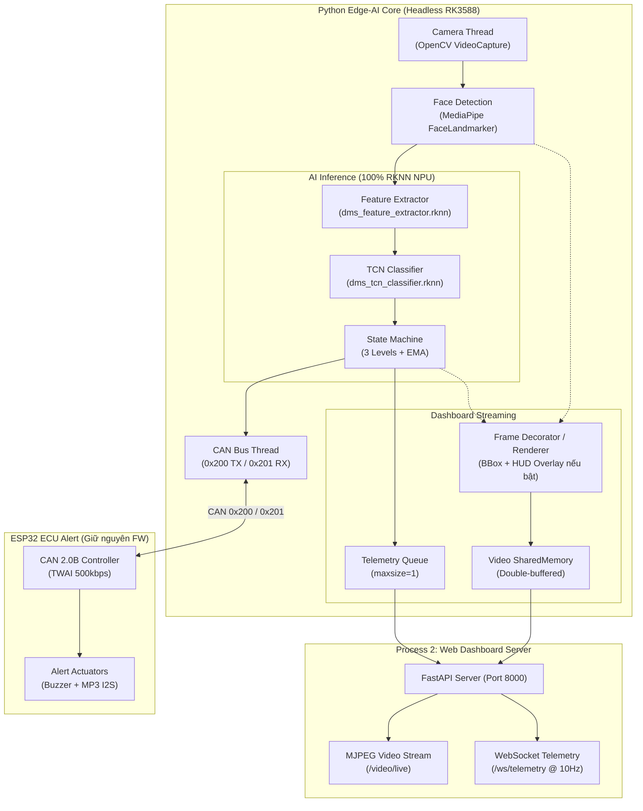

# 🔧 Deep Optimization & Cleanup Plan (v2)
## Branch: `refactor/deep-optimization-cleanup`

> [!IMPORTANT]
> **Mục tiêu cốt lõi:**
> 1. **100% RKNN NPU runtime**: Cả Feature Extractor và TCN Classifier đều chạy thuần RKNN NPU trên RK3588, loại bỏ triệt để mọi dependency và code liên quan đến ONNX / CUDA / DirectML.
> 2. **Chỉ giữ CAN Bus**: Loại bỏ hoàn toàn giao thức truyền thông Serial debug ở phía Python. Giữ nguyên firmware ESP32.
> 3. **Loại bỏ OpenCV GUI (Chuyển Headless)**: Không còn cửa sổ hiển thị cục bộ (`cv2.imshow`, `cv2.waitKey`, `destroyAllWindows`). Giữ lại cơ chế vẽ Bounding Box / HUD Overlay lên frame video để đẩy trực tiếp sang Client Dashboard thông qua Bridge (SharedMemory + MJPEG).
> 4. **Giữ các cấu hình và telemetry quan trọng**: `FACE_BBOX_ENABLED`, `HUD_OVERLAY_ENABLED`, `label_color`, `camera_fps` được giữ nguyên để phục vụ Dashboard stream.

---

## Kiến trúc Mục tiêu sau Tối ưu hóa



---

## Phase 1: Loại bỏ ONNX Runtime & CUDA — 100% RKNN NPU

### 1.1 — Mô hình RKNN cho TCN Classifier
- Hiện tại dự án đã có script `convert_onnx_to_rknn_uint8.py` cho Feature Extractor.
- **Bổ sung/cập nhật script chuyển đổi**: Tạo `scripts/convert_classifier_to_rknn.py` (hoặc mở rộng convert script) để biên dịch `dms_tcn_classifier.onnx` thành `dms_tcn_classifier.rknn` (input shape `[1, 16, 256]` float32, target `rk3588`, FP16 mode).
- Cả hai model RKNN sẽ nằm trong `models/`:
  - `models/dms_feature_extractor.rknn`
  - `models/dms_tcn_classifier.rknn`

### 1.2 — `src/config.py`
| Dòng | Thay đổi | Chi tiết |
|------|----------|----------|
| L18 | **XÓA** | `EXTRACTOR_ONNX` |
| L20 | **XÓA** | `CLASSIFIER_ONNX` |
| L19 | **GIỮ & CẬP NHẬT** | `EXTRACTOR_RKNN = str(MODEL_DIR / 'dms_feature_extractor.rknn')` |
| Mới | **THÊM** | `CLASSIFIER_RKNN = str(MODEL_DIR / 'dms_tcn_classifier.rknn')` |
| L103-116 | **XÓA** | Toàn bộ hàm `setup_cuda_dlls()` |
| L59-60 | **XÓA** | `IMAGENET_MEAN`, `IMAGENET_STD` (phần cứng NPU đã tự chuẩn hóa qua subgraph) |
| L10 | **XÓA** | `import numpy as np` không còn cần trong config |

### 1.3 — `src/inference/preprocessor.py`
| Hàm | Hành động | Lý do |
|-----|-----------|-------|
| `preprocess_crop_uint8()` | **GIỮ LẠI** | Chuẩn hóa uint8 NHWC tối ưu cho RKNN NPU |
| `to_onnx_input()` | **XÓA** | Không còn ONNX |
| `preprocess()` | **XÓA** | Wrapper cũ cho ONNX |

### 1.4 — `src/inference/engine.py` (Inference Engine)
| Vị trí | Thay đổi | Chi tiết |
|--------|----------|----------|
| Imports | **LÀM SẠCH** | Bỏ `setup_cuda_dlls`, `EXTRACTOR_ONNX`, `CLASSIFIER_ONNX`, `import onnxruntime as ort` |
| RKNN import | **BẮT BUỘC** | `from rknnlite.api import RKNNLite` (không fallback) |
| `_init_sessions()` | **THUẦN RKNN** | - Khởi tạo `self.rknn_extractor = RKNNLite()` (gán Core 0 hoặc Core 0+1)<br>- Khởi tạo `self.rknn_classifier = RKNNLite()` (gán Core 2)<br>- Bỏ toàn bộ khối `if not self._use_rknn:` và ONNX fallback provider checks |
| `run()` | **THUẦN RKNN** | - Feature extractor: `self.rknn_extractor.inference(inputs=[f_uint8, e_uint8, m_uint8])`<br>- TCN classifier: `self.rknn_classifier.inference(inputs=[feat_seq])` |
| `stop()` | **GIẢI PHÓNG** | Release cả 2 RKNNLite instances |

---

## Phase 2: Loại bỏ giao thức Serial Debug (Phía Python)

> [!NOTE]
> Theo phản hồi review: **Tạm thời không điều chỉnh firmware của ESP32**, chỉ loại bỏ trên mã nguồn Python Edge-AI.

### 2.1 — Xóa Package `src/debug/`
- **XÓA** `src/debug/serial_sender.py` (115 dòng)
- **XÓA** `src/debug/serial_debugger.py` (90 dòng)
- **XÓA** `src/debug/__init__.py` (5 dòng)
- **XÓA THƯ MỤC** `src/debug/`

### 2.2 — `src/config.py`
- **XÓA** các hằng số: `SERIAL_ENABLED`, `SERIAL_PORT`, `SERIAL_BAUDRATE`, `SERIAL_HEARTBEAT_INTERVAL`.

### 2.3 — `src/main.py`
- **XÓA** import `SERIAL_*` và `from src.debug.serial_debugger import SerialDebugger`.
- **XÓA** khởi tạo `debugger = SerialDebugger(...)`.
- **XÓA** `debugger.update(...)` trong main loop.
- **XÓA** `debugger.close()` trong block cleanup `finally`.

---

## Phase 3: Loại bỏ OpenCV GUI (Chuyển Headless) & Giữ Decorator cho Dashboard

> [!IMPORTANT]
> **Làm rõ mục tiêu:**
> - **LOẠI BỎ**: Mọi cơ chế hiển thị Desktop GUI của OpenCV (`cv2.imshow()`, `cv2.waitKey()`, `cv2.destroyAllWindows()`). Pipeline có thể chạy mượt mà trên môi trường Headless (không có monitor/X11/Wayland).
> - **GIỮ LẠI**: 
>   - Bounding Box và HUD Overlay vẫn được vẽ lên frame thông qua `Renderer` (hoặc Frame Decorator) để client xem trên **Web Dashboard** (`/video/live`).
>   - Giữ các cấu hình: `FACE_BBOX_ENABLED = True`, `HUD_OVERLAY_ENABLED = False` trong `src/config.py`.
>   - Giữ `label_color` trong `SharedState`.
>   - Giữ `camera_fps` (tính FPS camera để hiển thị trên overlay / telemetry snapshot).

### 3.1 — `src/main.py` — Chuyển Main Loop sang Headless + Signal Handling
- **XÓA**:
  ```python
  # XÓA CÁC DÒNG NÀY:
  cv2.imshow('DMS Pipeline v2 (Multi-Thread)', frame)
  if cv2.waitKey(1) & 0xFF == ord('q'):
      break
  ...
  cv2.destroyAllWindows()
  ```
- **GIỮ VÀ DUY TRÌ**:
  ```python
  # Vẽ Bounding Box / HUD Overlay lên frame nếu cấu hình bật
  renderer.draw(
      frame=frame,
      label_text=label_text,
      label_color=label_color,
      smoothed_drowsy_prob=smoothed_prob,
      current_mar=current_mar,
      region_weights=region_weights,
      camera_fps=camera_fps,
      payload=payload,
      face_detected=face_detected,
      alert_ecu_connected=alert_ecu_connected,
      alert_ecu_state=alert_ecu_state,
      alert_ecu_hw_health=alert_ecu_hw_health,
      hud_overlay_enabled=HUD_OVERLAY_ENABLED,
      face_bbox_enabled=FACE_BBOX_ENABLED,
      face_bbox=face_bbox,
  )

  # Đẩy frame đã vẽ + telemetry sang Dashboard Bridge qua SharedMemory
  if ipc_manager is not None:
      ipc_manager.write_video_frame(frame)
      ipc_manager.post_telemetry(state.get_telemetry_snapshot())
  ```
- **THÊM CƠ CHẾ THOÁT CHUẨN HEADLESS**:
  Bắt tín hiệu `SIGINT` (Ctrl+C) và `SIGTERM` bằng cờ `running = True` hoặc `try...except KeyboardInterrupt` để dừng sạch sẽ khi chạy qua `systemd` / terminal mà không cần phím `'q'` của OpenCV GUI.

---

## Phase 4: Code Cleanup & Tối ưu hóa Toàn diện

### 4.1 — `src/payload/can_payload.py`
- `to_display_dict()`: **GIỮ LẠI** vì dòng HUD Overlay trên video frame của Dashboard vẫn gọi hàm này để hiển thị mã Hex gói CAN và trạng thái giải mã.
- Cập nhật docstring: Chỉ rõ đây là payload chuẩn CAN Bus 8-byte, bỏ tham chiếu đến Serial UART.

### 4.2 — `src/shared_state.py`
- Giữ nguyên `label_color` và `camera_fps`.
- Thêm trường `camera_fps` vào `get_telemetry_snapshot()` để Web Dashboard trực tiếp hiển thị FPS camera nếu cần.

### 4.3 — Dead Imports & Dependencies
- Xóa import thừa: `onnxruntime`, `serial`, `pyserial`, `torch` (nếu có trong runtime src).
- Kiểm tra toàn bộ `src/` để đảm bảo code gọn gàng, không còn đoạn code chết (dead code) hoặc unused variables.

---

## Bảng So sánh Trước và Sau Tối ưu

| Thành phần | Trước tối ưu | Sau tối ưu |
|------------|-------------|------------|
| **AI Inference** | RKNN (Ext) + ONNX Fallback + CUDA/DML checks + ONNX CPU (TCN) | **100% RKNN NPU** (Cả Extractor & Classifier) |
| **Dependencies AI** | `onnxruntime`, `rknnlite`, `numpy`, `opencv` | `rknnlite`, `numpy`, `opencv` (Không còn ONNX/CUDA) |
| **Giao tiếp ngoại vi** | CAN Bus + Serial UART (ESP32 Debug) | **Duy nhất CAN Bus** (0x200 / 0x201) |
| **Module Serial** | `src/debug/` (210 dòng) | **Đã xóa hoàn toàn** |
| **Hiển thị hình ảnh** | Cửa sổ OpenCV GUI (`cv2.imshow`) + Dashboard | **Thuần Headless**, đẩy frame qua Bridge lên Web Dashboard |
| **Overlay / BBox** | Bật/tắt qua config | **Giữ nguyên**, hiển thị trên Web Dashboard qua MJPEG |
| **Firmware ESP32** | 12 files Arduino C++ | **Giữ nguyên 100%** |
| **Môi trường chạy** | Yêu cầu Desktop Display (X11) | **Hoạt động trơn tru trên Headless Linux / Embedded RK3588** |

---

## Kế hoạch Thực hiện Tuần tự

1. **Bước 1**: Tạo script chuyển đổi `dms_tcn_classifier.onnx` sang `dms_tcn_classifier.rknn`.
2. **Bước 2**: Tái cấu trúc `src/inference/preprocessor.py` và `src/inference/engine.py` sang 100% RKNN.
3. **Bước 3**: Xóa package `src/debug/`, gỡ cấu hình Serial khỏi `src/config.py` và `src/main.py`.
4. **Bước 4**: Gỡ bỏ `cv2.imshow` / GUI khỏi `src/main.py`, tinh gọn main loop theo chuẩn Headless và nối trực tiếp sang Bridge.
5. **Bước 5**: Kiểm tra cú pháp, imports, chạy smoke test toàn bộ pipeline.
